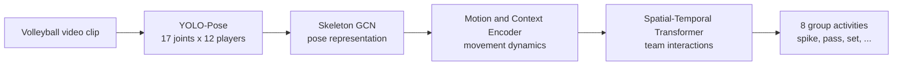

  

 

## About

I am an **AI and Machine Learning Engineer** specialized in **Computer Vision**. I build end-to-end systems: I design the model, build the data pipeline, and ship it behind a real API and interface. My research focuses on **skeleton-based group activity recognition** using Graph Neural Networks and Transformers, and I also build with **RAG, multi-agent systems, and LoRA/PEFT fine-tuning**.

| | |
|---|---|
| **Education** | B.Sc. Computer Science (AI), Benha University, GPA 3.4/4.0 (2022 to 2026) |
| **Currently** | Programming Tutor at iSchool, and looking for AI / Computer Vision / ML Engineer roles |
| **Recognition** | Codeforces Specialist, GCI World 2026 (University of Tokyo), Aspire Fellow |
| **Focus** | Computer Vision, Graph Neural Networks, Agentic AI, real-time inference |

 

## Results at a Glance

 

## Featured Projects

<table>
<tr>
<td width="50%" valign="top">

### Group Activity Recognition V2
**VAT-Former** classifies what a volleyball team is doing using only body keypoints, with no raw video frames.

`91.10% Top-1` &nbsp; `91.07% F1` &nbsp; `883K params`

- Watches 12 players at once and identifies 8 team-level activities
- 4,830 clips from 55 match videos, 17-joint YOLO-Pose extraction
- Skeleton GCN, Motion and Context Encoder, Spatial-Temporal Transformer
- 4-stage curriculum learning

`PyTorch` `GNN` `Transformer` `YOLO-Pose`

**[View repository](https://github.com/Bavleyhesham8/Group_Activity_Recognition_V2)**

</td>
<td width="50%" valign="top">

### SmartClass AI
A school attendance and security system: identifies registered students, logs attendance, detects raised hands, and alerts staff when an unknown person enters.

`CUDA-accelerated` &nbsp; `Real-time` &nbsp; `Role-based portals`

- InsightFace, YOLO, and ByteTrack pipeline
- Guided biometric enrollment with live pitch and yaw feedback
- React and FastAPI web layer for admins, teachers, and parents
- Edge sync through SQLite and NPZ bridging

`InsightFace` `YOLO` `FastAPI` `React`

**[View repository](https://github.com/Bavleyhesham8/Smart-classroom)**

</td>
</tr>
<tr>
<td width="50%" valign="top">

### AI-Powered Fitness Coach
A real-time CV backend for a hands-free AI personal trainer: rep counting, form-error detection, and corrective voice feedback.

`FastAPI + WebSockets` &nbsp; `30 FPS`

- Three-layer evaluation: geometric state machines, VAE-based quality rejection, STGCVAE for complex movements
- Voice commands with SpeechBrain and face-lock tracking

`MediaPipe` `PyTorch` `OpenCV` `FastAPI`

**[View repository](https://github.com/Bavleyhesham8/AI-Powered-Fitness-Coach.)**

</td>
<td width="50%" valign="top">

### Pathora: AI Career Assistant
Built during the DEPI Generative and Agentic AI internship. Parses CVs, predicts job fit, generates adaptive exams, evaluates answers with an LLM, and recommends courses to close skill gaps.

`Multi-agent` &nbsp; `LLM evaluation`

`FastAPI` `React` `LangChain` `CrewAI` `RAG`

</td>
</tr>
</table>

<b>VAT-Former architecture</b>

 

 

## Technical Skills

| Area | Tools and Techniques |
|---|---|
| **Computer Vision** | OpenCV, YOLO, YOLO-Pose, MediaPipe, InsightFace, ByteTrack, segmentation, SURF |
| **Deep Learning** | CNNs, LSTMs, VAEs, GANs, GCNs, Transformers, TCNs, LoRA/PEFT |
| **Agentic and LLM** | RAG, LangChain, CrewAI, multi-agent systems, prompt engineering |
| **Data and ML** | EDA, feature engineering, data pipelines, ETL, model evaluation |
| **Engineering** | FastAPI, WebSockets, real-time inference, edge deployment, CUDA |
| **Familiar with** | AWS, Docker, Kubernetes, CI/CD, MLOps basics |

 

## Experience

| Period | Role | Organization | Highlights |
|---|---|---|---|
| 07/2026 to Present | **Programming Tutor** | iSchool | Teaching Python, mBlock, and VEX Robot coding to grade 5 and 6 students |
| 12/2025 to 06/2026 | **Generative and Agentic AI Intern** | Digital Egypt Pioneers Initiative (DEPI) | Built Pathora; covered RAG, multi-agent systems, LoRA/PEFT, and cloud deployment of agents |
| 07/2025 to 08/2025 | **Computer Vision Trainee** | National Telecommunication Institute (NTI) | 120-hour program: image processing, edge detection, segmentation, SURF, YOLO |
| 10/2024 to 08/2025 | **Python and Problem-solving Instructor** | IEEE El-Shorouk Academy | Taught 25+ students, +30% pass rate, mentored 6 project teams |
| 2026 | **AI Data Annotator (Video)** | micro1 | Verified 2,200+ video descriptions with 100% hidden-check accuracy |

 

## Certifications and Honors

| Year | Recognition | Issuer |
|---|---|---|
| 2026 | **GCI World 2026**, 4-month competitive AI and Data Science scholarship | Matsuo-Iwasawa Laboratory, University of Tokyo |
| 2026 | **Machine Learning Diploma** | Get Skilled Academy |
| 2025 | **Aspire Fellow**, selected from a global cohort | Aspire Leaders Program |
| 2025 | **Building LLMs with Prompt Engineering** | NVIDIA |

 

<!--
OPTIONAL: live GitHub stats cards.
The public github-readme-stats instance is often rate-limited and shows errors,
so these are disabled by default. Uncomment only after self-hosting it.

-->

## Let's Build Something

If you are working on computer vision, agentic systems, or ML in production, I would like to hear about it.

